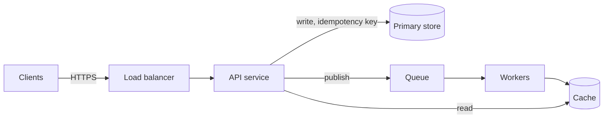

## What they're really asking

> **If you only remember one thing, say this in the first minute:**
> "The design round is the same; only the diagram is text. I'll keep it small, eight to twelve boxes, and label
> every arrow with what flows and the guarantee. I'll grow it in steps and say what changed each time. I'll ask the
> assistant targeted questions about the diagram that I can check by looking, and I won't let it rewrite the whole
> thing."
>
> The rest of this page explains each part of that answer.

In a normal design round you draw boxes and arrows on a whiteboard. In this version you write the diagram as text
instead, in a shared online code editor, and an **AI assistant** can read it. The assistant is a large language
model (LLM), the same kind of tool as ChatGPT or Claude: you type a request, called a **prompt**, and it writes back.

The text format is **Mermaid**: a small language for diagrams. You write `A --> B` and it draws an arrow from box A
to box B. The reason for the switch is simple. The assistant can read text, but not a drawing. Once the diagram is
text, it can check your diagram, and you can ask it questions about it.

Nothing else about the round changes. You still clarify, size the system, draw the architecture and go deep. The
format only adds a new way to waste minutes (fighting the syntax) and a new tool to use well (asking the assistant
about the diagram).

The report comes from a prep guide, not a candidate post. Hello Interview's Meta E6 guide (E6 is Meta's Staff
engineer level) says some candidates capture the architecture "as Mermaid markdown inside a CoderPad environment"
(CoderPad is a shared online code editor), because the AI can read diagram syntax but "can't parse a hand-drawn
canvas". A few spring-2026 candidates were told to expect this on both design rounds. The guide calls it "early
signal" that varies by team (<Cite id="s-be529bb3fa" />). At E6, design is "the part of the loop that most drives
your E6 level determination" (<Cite id="s-be529bb3fa" />). So fluency with the format matters less than the design, but clumsiness with it
still costs minutes.

## Clarify first

- **Is the AI assistant available in this design round**, and can it see the whole pad?
- **Is Mermaid required, or just allowed?** Is a plain list of components acceptable?
- **Should the diagram grow** with the discussion, or do you want one final version?
- **The usual design questions** come first: users, scale, latency, consistency and what is out of scope.

Say it like this: "Before I start drawing, is Mermaid required, and can the assistant see the pad?"

## Answer

### A small diagram, written as text

Practise writing a small Mermaid flowchart fast enough that it doesn't slow your talking. A diagram of eight to
twelve boxes covers most designs. Here is a generic web backend, the kind of first draft you write in two minutes:



How to read it: `flowchart LR` means "draw left to right". `C[Clients]` makes a box with id `C` and label
"Clients". `[( … )]` draws a cylinder, the usual shape for a store. `-->|publish|` draws an arrow with the label
"publish". That is nearly all the syntax you need.

Drawn as boxes, it looks like this:

```
Clients
   │ HTTPS
   ▼
Load balancer
   │
   ▼
API service ──write, idempotency key──► Primary store
   │    │
   │    └──read──► Cache ◄── Workers
   │ publish                    ▲
   ▼                            │
 Queue ─────────────────────────┘
```

### Follow one diagram through the round

Take the diagram above and suppose the requirement is "a user's deletes must be visible to everyone within a
minute". Here is how the diagram and the conversation move together.

| Step | What you change in the text | What to say in the interview |
|---|---|---|
| 1. First draft | The seven lines above, from the requirements. | "This is my first cut from the requirements. I'll grow it as we go." |
| 2. Label the guarantees | Change `-->|publish|` to `-->|publish, at-least-once|`. | "The label says what the queue promises. That's what you'll want to probe." |
| 3. Ask the assistant | "Does anything here contradict the requirement that deletes are visible within a minute?" | "I'm asking it something I can check by looking at the diagram." |
| 4. Judge the answer | It points at the cache: a delete may stay in the cache. You add `W -->|invalidate on delete| Cache`. | "Good catch. I'll add an invalidation edge and give cache entries a time limit under a minute." |
| 5. Deep dive | Two or three new lines, nothing else rewritten. | "Here's what changed and why." |

The assistant's reply in step 4 is illustrative. The shape of the exchange is the point: a targeted question, an
answer you can verify, and a small edit you make yourself.

### Habits that make the format work for you

- **Label arrows with what flows and the guarantee** ("publish, at-least-once"), not just arrows. The labels carry
  the design. An unlabelled arrow says nothing an interviewer can probe.
- **Grow it in steps.** Write a first draft from the requirements. Then each deep dive adds or changes two or three
  lines. Say what changed.
- **Ask the assistant targeted questions** whose answers you can check by looking: "Which edge has no retry path?",
  "Which node holds state that isn't replicated?", "Does anything here contradict the requirement that deletes are
  visible within a minute?"
- **Don't let it rewrite the diagram wholesale.** A regenerated diagram you didn't shape is hard to defend, and it
  looks like the assistant designing the system.
- **Keep numbers next to the diagram** as comments or a short list. The assistant reads them too and can check
  that they are consistent.

## Senior vs Staff

<LevelContrast
  title="Mermaid design with AI"
  senior={["A clear, labelled diagram that grows with the discussion, with targeted checks from the assistant and corrections made out loud."]}
  staff={["Uses the text form to make trade-offs explicit (labelled guarantees, ownership boundaries), asks the assistant for contradictions with the requirements, and keeps control of the narrative in a round that most drives the E6 level."]}
/>

## Small-team version

Diagrams as text are useful at a small company whether or not you're interviewing. Mermaid in a design doc or a
README shows up in diffs and code review, and an assistant can check it against the written requirements. Keep the
diagram next to the requirements and numbers, ask the assistant for contradictions, and have one person review it
before anything hard to reverse ships.

The assistant is priced per **token**, a chunk of text of roughly ¾ of a word, counted on what you send and what
it writes back. The tokens cost almost nothing: an assumed 20 checks of a 10,000-token doc, each returning 1,500
tokens, cost about **$0.70** at Claude Sonnet 5 list prices (fetched 2026-10-11). An hour of the reviewer's time,
about **$93** at an assumed $194K yearly loaded cost, is the real cost. So spend money on the review, not on
avoiding tokens.

<details>
<summary>The arithmetic behind the numbers (for a Staff-level follow-up)</summary>

- Tokens: 20 × (10,000 × $2 + 1,500 × $10) ÷ 10⁶ = **$0.70**, at $2 per million input tokens and $10 per million
  output tokens.
- Reviewer: $194,000 ÷ 2,080 working hours ≈ **$93 an hour**.

</details>

## Pitfalls

- **Learning Mermaid syntax during the interview.** Practise until a ten-box diagram takes two minutes.
- **Unlabelled arrows.** They hide delivery guarantees and who owns what.
- **Letting the assistant regenerate the whole diagram.** You can't defend a design you didn't shape.
- **Assuming you'll get this format.** It is early signal and varies by team.

## Go deeper

- Family walkthrough: [System design with an AI assistant in the room](/system-design-labs/interviews/walkthroughs/ai-assisted-system-design/), especially "High-level design" and "Deep dive 3".
- Build one box from a typical diagram: <LabRef lab="websocket-gateway" inline />.
