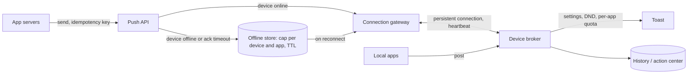

## The prompt

> **If you only remember one thing, say this in the first minute:**
> "I'll run this like a normal design round. I'll agree the requirements with you, not with the assistant, and
> I'll write my own numbers before I ask it anything. Then I'll use it for breadth: a list of components, failure
> modes I might miss, a first diagram. For anything specific, like a capacity figure or the exact meaning of a
> query, I'll check it myself and tell you out loud what I kept, what I changed and what I threw away."
>
> The rest of this page explains each part of that answer.

### What makes this round different

You already know the classic system design round. The interviewer gives you a vague product ("design a
notification system"). You ask questions, agree the scope, estimate the load, draw boxes and arrows, and then go
deep on the two or three parts that are hard. The interviewer is watching how you think.

In this version, a chat window with an **AI assistant** sits next to the whiteboard or shared editor. It is a
large language model (LLM), the same kind of tool as ChatGPT or Claude: you type a request in plain English, and
it writes back. The request you type is called a **prompt**. The assistant has read a great deal of public writing
about system design, so it can produce a complete-looking architecture in about ten seconds.

That changes the round in three ways:

1. **A full answer is always one prompt away.** So producing a design is no longer the hard part. The interviewer
   can only learn about *you* from the choices you make: what you ask for, what you accept, what you reject.
2. **The assistant is fluent but not reliable on specifics.** It is good at breadth: listing components, listing
   failure modes, drafting a diagram. It is weak at the specific facts of *your* problem: your traffic numbers, your
   edge cases, what a vague word in the prompt really means. Worse, it sounds equally sure in both cases.
3. **Checking costs time.** Everything the assistant writes must pass through your judgment before it goes into
   the design. A quick look is enough for a list of components. A capacity figure needs arithmetic. A tricky
   query needs a precise definition.

So the skill being tested is old and new at once. The design bar is the same. What is new is whether you stay the
owner of the requirements and the numbers while a confident assistant offers you a finished-looking answer.

### Three versions of the round

Three reports make up this family. In each, the AI is used differently:

- **Optional.** Meta gave a candidate a chat window to "unblock yourself as needed" during a leaderboard design.
- **Required and graded.** Microsoft required it during a notification-system design and graded how the
  candidate prompted it and judged its answers.
- **Diagram written as text.** A Meta prep guide says some candidates write the architecture as **Mermaid**, a
  small text language for diagrams (`A --> B` draws an arrow from A to B), so the assistant can read it.

Each came from one candidate post or one prep guide, so treat the details as approximate.

<QuestionRow id="r2a-006" />
<QuestionRow id="r2a-012" />
<QuestionRow id="r2b-012" />

| Company | What was reported | Source |
|---|---|---|
| Meta (SWE, Sep 2026) | Onsite of "2 AI coding rounds + 2 AI system design rounds + 1 BQ" (BQ is the behavioral round). One design was a video-game leaderboard (players, games, friends, one high score per player per game) that must "show the closest scores" when a game ends, a "range search over a large dataset". The other was a ride-share system. Interviewers gave an AI chat window to "unblock yourself as needed" | <Cite id="s-6728fdb0b3" /> |
| Microsoft (SDE-2, Sep 2026) | Design a notification system for Windows where many applications create and display notifications. AI was "allowed in this round, and actually required"; the interviewer focused on "how you write prompts, how you refine them, and how you evaluate the answers the AI gives you" | <Cite id="s-0b4f53a555" /> <Cite id="s-d302bba651" /> |
| Meta (E6, the Staff level; spring 2026, prep site) | Hello Interview says some candidates capture the architecture "as Mermaid markdown inside a CoderPad environment" (CoderPad is a shared online code editor), because the AI can read diagram syntax but "can't parse a hand-drawn canvas". A few were told to expect it on both design rounds. Hello Interview calls this "early signal" that varies by team | <Cite id="s-be529bb3fa" /> |

### The examples that run through this page

One example runs from start to finish: **the Microsoft notification system**, because that is the round where
the way you use the assistant was graded. We follow it through clarifying, sizing, the diagram, and one full
prompt-and-judge session with a running clock.

The Meta leaderboard appears as the second deep dive. It shows the other half of the skill: a single vague word
("closest") that the assistant will happily interpret for you, wrongly. A small prototype of it was written and
tested by script on 2026-10-12. Every traffic figure on this page is an assumption, and is labelled as one.

## What is being tested

### The design, mostly as before

The Meta candidate called these "decades-old classic system design questions". They said that system design "is
really about demonstrating your depth of knowledge", so they "didn't feel there was much of a positive use case"
for the AI. They used it a little for drawing, and report that "some interviewers straight up say they don't
recommend it" (<Cite id="s-6728fdb0b3" />).

At Meta's E6 level (Staff engineer), the design round is "the part of the loop that most drives your E6 level
determination" (<Cite id="s-be529bb3fa" />). So the assistant does not lower the bar. A weak design with clever
prompting is still a weak design.

### Judgment about the assistant's output, when the round requires it

The Microsoft report is the only one where AI use was required and graded. What was graded was prompting,
refinement and evaluation, "not just" taking the AI's output and using it (<Cite id="s-0b4f53a555" />). Canva says
something similar about its own AI-assisted coding round: successful candidates "didn't just prompt AI and accept
whatever it generated" (<Cite id="s-88d61cb9fa" />).

In plain terms, the interviewer wants to see three things:

- **You write good requests.** A good prompt carries your requirements and your numbers, and asks for something
  bounded. A bad one is the interview question pasted in.
- **You improve the answer.** When the first reply is generic, you know how to push it: add constraints, ask it to
  argue against itself.
- **You judge the answer.** You check the reply against the requirements and your arithmetic, and you say out
  loud what you keep and why.

### This page's reading

You are graded on the same design signals as a normal round, plus one new one: can you keep ownership of the
requirements and the numbers while a fluent assistant offers a complete-looking answer?

A simple rule follows from that. Some things are **cheap to check**: a list of components, a list of failure
modes, a diagram of what you already said. You can check them by reading. Some things are **expensive to check**:
a capacity figure, the meaning of "closest", where duplicate messages come from. You check those with arithmetic,
a precise definition or a test. Use the assistant for the first kind. For the second kind, write your own version
and ask the assistant to criticise it.

Say it like this: "I'll use the assistant for breadth, where I can check its answer by reading it. The numbers and
the definitions I'll do myself, and I'll ask it to check them."

## Clarify and scope

Ask the interviewer, not the assistant. The assistant doesn't know what this interviewer has in mind. Asking it
first also looks like handing over the problem. Say it like this: "Before I touch the assistant, let me pin down
the requirements with you."

### Notification system (Microsoft): the running example

1. **On-device, cloud push, or both?** "Many applications create and display notifications" can mean two things.
   It can mean the platform on one PC: apps post notifications, and the operating system shows and stores them. Or
   it can mean the cloud path that carries a notification from an app's server to the device. Assume both, with the
   device side first, and say so.
2. **Delivery guarantee.** Best effort (some may be lost), or **at-least-once** (never lost, but sometimes delivered
   twice)? Assume at-least-once for the cloud path. The device then removes duplicates using a notification id.
   Removing duplicates is called **dedup**.
3. **User controls.** Do-not-disturb, per-app on/off, priority. Assume all three.
4. **Scale.** Number of devices, notifications per device per day, and the **peak factor** (how much busier the
   busiest hour is than the average). If the interviewer doesn't give them, write your own assumptions down.
5. **Offline devices.** How long do we hold notifications for a device that is switched off? Assume a cap per
   device and app, plus a time limit.

### Leaderboard (Meta): the second example

1. **"Closest scores" by rank or by score?** "You are #4,512; here are the players around you" (by rank) is not the
   same as "the scores nearest yours" (by absolute difference). Ask. Assume both are wanted and show the
   difference.
2. **Global or friends?** Assume both, because the prompt lists friends.
3. **Ties.** How are equal scores ordered? Assume higher score first, then a stable player-id order.
4. **One best score per player per game.** A new score replaces the old one only when it is higher.
5. **Freshness.** Must a new score appear immediately? Assume within a second for the player's own view.

**Out of scope** unless asked: checking that scores aren't cheated, seasons, and how notification content is
rendered.

## Back-of-envelope

Write your own numbers before you ask the assistant for any. Then ask it to check your arithmetic, and redo
anything it disagrees with yourself. If you ask the assistant for the numbers first, you lose the main thing the
interviewer can see you do.

### What the notification numbers mean

The obvious number is the notification rate. With the assumed inputs below it is about **347,000 notifications a
second at peak**. That sounds like the number that sizes the system. It isn't.

To push a notification within seconds, each online device keeps a **persistent connection** open to a server we
call the **connection gateway**. To know the connection is still alive, the device sends a tiny "I'm here"
message every 30 seconds. That message is a **heartbeat**. (The websocket-gateway lab uses a 30-second ping.)

Heartbeats arrive whether or not anyone sends a notification. With 300 million devices connected, that is **10
million heartbeats a second**, nearly 30 times the notification rate. So the heartbeat interval and the number of
connected devices, not the notification rate, set the size of the gateway tier. At an assumed 200,000 connections
per gateway machine, that is **1,500 machines**.

This is exactly the kind of figure where an assistant goes wrong. It sizes by the number in the question, because
that is the number it was given. Say it like this: "The tier is sized by connections and heartbeats, not by
notifications. Ten million heartbeats a second against three hundred and fifty thousand notifications."

The other two numbers are smaller concerns:

- **Outgoing bandwidth** at peak, with an assumed 4 KB maximum notification: about **1.42 GB/s**.
- **Offline storage**, if every device hits an assumed cap of 50 notifications of 1 KB: about **25.6 TB** worst
  case. A **collapse key** (keep only the latest notification of each kind per app, for example the newest
  "3 unread messages") cuts that a lot.

### What the leaderboard numbers mean

The leaderboard sounds big, but the numbers are small. At peak, about **2,900 scores a second** arrive for the
biggest game. All the best scores for that game fit in about **2 GB** of memory, so one sorted structure per game
fits on one machine, copied to a few replicas for reads. A sorted structure finds any position in about **24
steps** for 20 million entries (it costs O(log n) per operation).

The number that matters is the **friends** feature. There are two ways to build "closest scores among my
friends":

- **Fan-out on read:** when a game ends, look up each friend's best score and sort them. With an assumed 100 friends,
  that is about **289,000 lookups a second** at peak.
- **Fan-out on write:** when a player improves their best score, write the new score into each friend's private
  board. That is about **58,000 writes a second** (if an assumed 20% of games improve a best score), but the friend
  boards take about **200 GB**.

Neither is obviously right. It depends on how often scores improve and how many friends people have. Say it like
this: "Friends is the part that sets the load. Can you tell me how often a best score improves, and what the
friend-count distribution looks like?"

<details>
<summary>The arithmetic behind the numbers (for a Staff-level follow-up)</summary>

Every input here is an assumption. The rule for turning a daily count into a peak rate is:
peak per second = (events per day ÷ 86,400 seconds) × peak factor.

**Notifications**

- Daily volume: 500M devices × 20 notifications a day = 10B a day.
- Average: 10B ÷ 86,400 = **115,741 a second**. Peak at an assumed factor of 3: **347,222 a second**.
- Heartbeats: 300M devices connected at peak ÷ 30 s = **10M a second**. At a 300 s interval it would be 1M a
  second.
- Gateway machines: 300M ÷ 200K connections each = **1,500**.
- Bandwidth: 347,222 × 4,096 bytes ≈ **1.42 GB/s** at the 4 KB maximum.
- Offline storage: 500M devices × 50 notifications × 1,024 bytes ≈ **25.6 TB** worst case.

**Leaderboard**

- Submissions: 50M games finished a day in the biggest game ÷ 86,400 = 578.7 a second. Peak at an assumed factor
  of 5: **2,894 a second**.
- Memory: 20M players × an assumed 100 bytes per entry (with index overhead) = **2.0 GB**.
- Depth: log₂(20M) ≈ 24 levels.
- Friends, fan-out on read: 2,894 × 100 friends ≈ **289K lookups a second**.
- Friends, fan-out on write: 2,894 × 0.2 improve × 100 friends ≈ **58K writes a second**.
- Friend boards: 20M players × 100 friends × 100 bytes = **200 GB**.

</details>

## High-level design

### The picture

Here is the notification system. Read it top to bottom; local apps on the same PC join at the device broker.

```
App servers (a calendar app's backend, a chat app's backend, ...)
   │  1. "send this to device D" + an idempotency key
   ▼
Push API ── checks the app's quota, records the key
   │
   ├── device online ──────────► Connection gateway ── holds one open connection per device,
   │                                   │                 receives heartbeats, waits for an ack
   │                                   │  2. push over the open connection
   │                                   ▼
   └── device offline ──► Offline store ── capped per device and app, expires after a time limit
                               │  3. delivered when the device reconnects
                               ▼
                         Device broker (on the PC) ◄── local apps post here directly
                               │  4. settings, do-not-disturb, per-app quota, dedup by id
                               ▼
                         Toast on screen  +  History (the notification list)
```

**App servers** are the backends of the apps that want to notify someone. They don't talk to devices directly.
They call our push API.

**The push API** accepts a request to notify one device. Each request carries an **idempotency key**: a unique id
chosen by the sender, so that a retried request is recognised and not sent twice. The API also checks the
sending app's quota.

**The connection gateway** is a large fleet of machines holding the persistent connections. When a notification
arrives for an online device, the gateway pushes it down that device's connection and waits for an
**acknowledgement** (an "ack": the device saying "got it"). If no ack arrives in time, the notification goes to
the offline store and is retried later. That retry is where duplicates come from.

**The offline store** holds notifications for devices that are switched off. It is capped per device and per
app, and entries expire. When the device reconnects, the gateway drains its entries.

**The device broker** is one service on each PC. Every app, local or remote, hands its notifications to it. It
checks the user's settings and do-not-disturb, applies a per-app **token bucket** (each app gets a budget of
notifications that refills at a fixed rate), drops duplicates by notification id, shows the toast and writes the
history. Apps never draw notifications themselves. That is how one misbehaving app is contained.

### Follow one notification through it

A calendar app's server wants to show "Team sync in 5 minutes" on one laptop.

| Step | What happens | What to say in the interview |
|---|---|---|
| 1 | The calendar server calls the push API with the device id and an idempotency key, say `cal-7781`. | "Every send carries a key, so a retry from the sender can't create a second notification." |
| 2 | The laptop is online. The gateway pushes the notification down its open connection. | "Delivery is a push down a connection we already hold, so it arrives in about a second." |
| 3 | The ack is lost on a flaky network. The gateway times out and stores the notification for retry. | "At-least-once means we'd rather send twice than lose it." |
| 4 | The retry arrives at the laptop. The broker sees id `cal-7781` again and drops it. | "Duplicates are fixed on the device, by id. That's cheap, and lost notifications can't be fixed at all." |
| 5 | The user has do-not-disturb on. The broker writes the reminder to history without a toast. | "User settings are applied in one place, on the device, for every app." |

### The same diagram as Mermaid

This is the same architecture written as Mermaid, which is what the Meta E6 variant reportedly asks for. Writing it
as text is also the fastest way to get the assistant to criticise it, because it reads every box and arrow
exactly.



(TTL, "time to live", is the time limit after which a stored notification expires. DND is do-not-disturb.)

### The leaderboard, in one paragraph

For each game, keep one sorted structure of entries `(−score, player id)`. The minus sign puts the highest score
first; the player id breaks ties. Split the games across machines, so each game lives on one. A new score is a
**conditional update**: replace the player's entry only if the new score is higher. "Players around me" is a
lookup of my position plus a window on each side. "Closest scores" is a jump to the submitted score and a walk
outward in both directions. Friends' views either look up and sort the friends' scores, or read a precomputed
friend board (the trade-off from the numbers above).

## Deep dives

### Deep dive 1: prompting and judging, the Microsoft way

The Microsoft round graded how you write, refine and evaluate prompts (<Cite id="s-0b4f53a555" />). Here is what
that looks like in a real session. Three prompts show the progression from bad to good:

```text
v1 (too vague, shows nothing about you):
  Design a Windows notification system.

v2 (your requirements and numbers, a bounded ask):
  Design the cloud path of a notification system. Requirements: at-least-once delivery,
  dedup on the device by notification id, offline devices hold at most 50 per app for 24 h,
  per-app quotas, user do-not-disturb. Assume 500M devices, 300M connected at peak,
  347K notifications/s at peak. List the components and the data each one stores.
  Don't choose technologies yet. Mark anything you assume that I didn't state.

v3 (make it argue against itself):
  For the design above, list the five most likely failure modes in order of impact,
  what detects each and what degrades. Then check my numbers: 300M connections with a
  30 s heartbeat is 10M heartbeats/s. Is the arithmetic right, and what does it imply?
```

Why v2 is better than v1: v1 gives the assistant nothing of yours, so its answer is a generic design that shows
the interviewer nothing about you. v2 hands it your requirements and numbers, limits what it may produce
(components and their data, no technology choices yet), and asks it to flag its own guesses. v3 turns the
assistant into a critic of the design rather than its author.

#### The session, with a running clock

Here is the notification round as one 45-minute session. The assistant's replies are illustrative: they are the
kind of answer such a tool gives, not a transcript.

| Clock | What you do | What the assistant gives back | What to say in the interview |
|---|---|---|---|
| 0–5 min | Clarify with the interviewer: both paths, at-least-once, user controls, offline cap. | Nothing yet. You haven't used it. | "Let me agree the requirements with you before I touch the assistant." |
| 5–10 min | Write your numbers on the pad: 347K notifications/s, 300M connected, 10M heartbeats/s. | Nothing yet. | "Heartbeats, not notifications, size the connection tier." |
| 10–13 min | Send prompt v2. | A list of components with the data each stores. It includes "one message-queue topic per device for offline delivery". | "Most of this matches my list. One item I don't accept, and I'll explain why." |
| 13–16 min | Judge the topic-per-device idea against your numbers. | — | "That's 500 million topics. Partitioned logs aren't built for that. I'll use a store keyed by device id instead." |
| 16–25 min | Draw the diagram (or write the Mermaid) from the parts you kept. | — | "Here's what I kept, what I changed and what I dropped." |
| 25–28 min | Send prompt v3. | Five failure modes. It agrees with the heartbeat arithmetic. It says one gateway machine holds a million connections. | "Good failure list. The million-connections figure has no source; I'll keep my own assumption and say what would test it." |
| 28–40 min | Go deep: duplicates from lost acks, reconnect storms, per-app quotas. | Used once more, to list what a gateway deploy breaks. | "Here's what happens when a release forces millions of devices to reconnect at once." |
| 40–45 min | Summarise, including your list of accepted, changed and rejected claims. | — | "Every part of the design went through this check." |

#### The checklist you judge each reply against

Judge every reply against the same four questions, out loud:

1. **Does it meet the stated requirements?** Tick each one. A reply that drops the offline cap or the dedup has
   ignored a requirement, however fluent it is.
2. **Do its numbers match yours?** Recompute anything new it introduces. If it says a machine holds a million
   connections, ask where that comes from. Treat it as an assumption to test, not a fact.
3. **Does each component's state make sense at your scale?** This is where confident proposals usually fail.
   Take the topic-per-device idea from the session. Check it against the numbers: 500M topics is far beyond what
   partitioned logs are designed for. (In a partitioned log such as Kafka, each partition carries its own files
   and metadata, so partitions are a scarce, heavyweight unit.) Say so, and replace it with a store keyed by device id.
4. **What did it leave out?** Typically: who enforces per-app quotas, how acks and retries create duplicates, and
   what happens during a gateway deploy when millions of devices reconnect at once.

The point is not to catch the assistant out. It is to show that every part of the design passed through your
judgment, which is what the round reportedly graded.

### Deep dive 2: "closest scores" is a precise spec

"Show the closest scores" sounds like one query. Defined precisely, it has edge cases. Here is a small board for
one game, used for the rest of this deep dive (illustrative values):

| Rank | Player | Best score |
|---|---|---|
| 1 | Ana | 50 |
| 2 | Bo | 41 |
| 3 | Cy | 40 |
| 4 | Gus (just finished) | 30 |
| 5 | Dee | 22 |
| 6 | Eve | 21 |

Gus finishes a game with 30 and asks to see two players near him.

- **By rank**, one on each side: Cy (40) and Dee (22). This is "the players around you".
- **By score**, the two nearest: Dee (22, 8 away) and Eve (21, 9 away). Cy is 10 away, so Cy is *not* included.

Same board, same player, different answers. An assistant asked to "show the closest scores" can easily take
the rank version, because it's the common pattern: find the rank and read k entries on each side. If the product
meant "by score", that answer is wrong, and it looks right.

Three more edge cases make it harder:

- **Ties.** If two players are equally far away, which comes first? Our rule: higher score first, then player id.
- **Gus himself.** He shouldn't appear in his own list.
- **Resubmits.** If Gus later scores 35, his old entry at 30 must be removed. Otherwise he appears twice.

The prototype below was written in scratch and checked against a **brute-force oracle**: a slow, obviously
correct version (sort every entry by distance and take the first k) that the fast version must always agree with.
In the code, `bisect` finds a position in a sorted list by binary search, and `heapq.merge` merges two already
sorted streams into one.

```python
class GameBoard:
    """order holds (-score, player_id): index 0 is the top score; ties sort by player id."""

    def submit(self, player, score):
        old = self.best.get(player)
        if old is not None and score <= old:
            return False                                   # one high score per player per game
        if old is not None:
            del self.order[bisect.bisect_left(self.order, (-old, player))]
        bisect.insort(self.order, (-score, player))
        self.best[player] = score
        return True

    def closest(self, score, k, exclude=None):
        """k entries nearest to score; ties: higher score, then lower player id."""
        i = bisect.bisect_left(self.order, (-score, ""))    # first entry with score <= `score`

        def above():                     # nearest first, equal scores in player-id order
            j = i
            while j > 0:
                start = bisect.bisect_left(self.order, (self.order[j - 1][0], ""))
                yield from self.order[start:j]
                j = start

        key = lambda e: (abs(-e[0] - score), e[0], e[1])
        out = []
        for neg, p in heapq.merge(above(), iter(self.order[i:]), key=key):
            if p != exclude:
                out.append((p, -neg))
                if len(out) == k:
                    break
        return out
```

How `closest` works, in words: jump to the first entry at or below the target score. Walk upward (higher scores)
and downward (lower scores) at the same time, always taking whichever side is nearer. Skip the player himself.
Stop after k entries. The `above()` helper exists for one reason: when it walks upward, equal scores must still
come out in player-id order, so it steps over each group of equal scores as a block.

The test builds 3,000 random small boards with many ties and resubmits, and checks the fast version against the
oracle each time:

```python
def test_closest_matches_brute_force_with_ties_and_resubmits():
    rng = random.Random(11)
    for trial in range(3_000):
        b = GameBoard()
        players = [f"p{i:03d}" for i in range(rng.randint(1, 40))]
        for _ in range(rng.randint(1, 80)):
            b.submit(rng.choice(players), rng.randint(0, 20))   # small range: many ties
        me = rng.choice(players)
        score, k = rng.randint(0, 20), rng.randint(1, 8)
        assert b.closest(score, k, exclude=me) == oracle_closest(b.best, score, k, exclude=me), trial
        assert len(b.order) == len(b.best)                          # no stale duplicates
```

Two plausible first drafts were also written and run against the same tests on 2026-10-12. Both look correct when
you read them.

| Draft | What it did | What the tests said |
|---|---|---|
| Walk upward with `reversed(order[:i])` | Equal scores above the pivot come out in reverse player order | The oracle test failed on trial 4: `('p024', 20) != ('p001', 20)` |
| `submit` inserts without removing the old entry | A player who improves appears twice | The keep-best test failed: `[(-70, 'ana'), (-50, 'ana')]` |
| The version above | — | 3 passed, 3,000 random boards with many ties |

You wouldn't write this in a 45-minute design round. You practise it beforehand, so that when the assistant
proposes "take the rank and read k on each side", you can say in one sentence what that returns and what it
misses. Say it like this: "That gives neighbours by rank. Nearest by score needs a merge of both sides with a tie
rule, and the two can differ."

### Deep dive 3: Mermaid as the shared artifact

If the round puts the diagram in Mermaid (<Cite id="s-be529bb3fa" />), use that to your advantage:

- **Keep it small:** eight to twelve boxes.
- **Label every arrow** with what flows and the guarantee ("send, idempotency key"). An unlabelled arrow says
  nothing an interviewer can probe.
- **Ask the assistant targeted questions about it:** "Which edge has no retry path?", "Which node holds state that
  isn't replicated?" You can check those answers by looking at the diagram, so they are cheap to verify.

## Failure modes and overload

| Failure | What you see | What you do |
|---|---|---|
| Gateway deploy or crash | Millions of devices reconnect at once | Devices wait a random, growing delay before reconnecting (jittered backoff); drain one machine at a time; the gateway admits connections at a set rate |
| Ack lost after delivery | Duplicate notification | At-least-once plus device-side dedup by notification id |
| One app floods | Toast spam, offline store fills | Per-app token bucket on the device and per-app quota at the push API; collapse keys |
| Offline store grows | Storage climbs during an outage | Cap per device and app, time limit, drop oldest first, count the drops |
| Hot game on the leaderboard | One machine's write rate spikes | Split the hot game by score range, or buffer submissions and apply them in batches; serve reads from replicas |
| Exact rank over a huge board | Rank queries get slow | Approximate rank from counts per score bucket for distant players; exact neighbours stay cheap |

The first row is the one most designs miss. A reconnect storm happens on every deploy, not only in a disaster.
If 300 million devices each reconnect within seconds, the gateway sees a burst far larger than any notification
peak. Say it like this: "Deploys are my worst load event, so devices back off with jitter and we drain one machine
at a time."

<Pitfall title="Trusting an assistant's capacity figure">
A number the assistant states fluently ("each node handles a million connections") is an assumption with no
source. Write it down as an assumption, ask what it depends on (memory per connection, heartbeat rate, the cost of
encryption), and size from your own inputs.
</Pitfall>

## Evals and observability

There are three things to measure here: the system, the assistant's part in the round, and the assistant's part
in your real design work.

**For the system.** End-to-end delivery time (median and p99, from push API accept to device ack). Delivered
divided by accepted. Duplicates shown per million. Per-app throttle counts. Offline-store drops. Connected-device
count and reconnect rate. For the leaderboard: the delay from submit to visible, and the p99 latency of "closest"
and "around me".

**For the assistant's part, in the round.** Keep a visible list of the assistant's claims you accepted, changed or
rejected, and why. It takes one line per claim. From the session above:

| Claim | Decision | Why |
|---|---|---|
| Components: push API, gateway, offline store, broker | Accepted | Matches the requirements |
| One queue topic per device | Changed | 500M topics; use a store keyed by device id |
| 10M heartbeats/s | Accepted | Matches my arithmetic |
| One machine holds 1M connections | Rejected as a fact | No source; kept my 200K assumption, to be load-tested |

That list is exactly the evidence the Microsoft round graded.

**For your own design docs at work.** The same list belongs in the doc, under a heading like "AI-suggested and
checked".

## Trade-offs

- **Persistent connections vs polling.** Connections deliver in seconds but cost a large always-on tier whose
  size is set by the heartbeat. Polling (the device asks "anything new?" every few minutes) is cheap and slow.
  Choose by the delivery time the product needs.
- **At-least-once vs at-most-once.** Duplicates can be fixed on the device; lost notifications can't. Choose
  at-least-once with dedup.
- **Friends: fan-out on read vs on write.** Read fan-out costs lookups on every game end. Write fan-out costs
  storage and writes on every improvement. Decide from the improvement rate and the friend counts.
- **Exact vs approximate rank.** Exact neighbours are cheap with a sorted index. Exact global rank for every player
  is what gets expensive.
- **How much AI to use.** Where it is optional, a short, targeted use (criticise the diagram, check arithmetic,
  list failure modes) beats a long generated draft. Some Meta interviewers reportedly don't recommend it at all
  (<Cite id="s-6728fdb0b3" />). Where it is required, make every use visible and judged.

<AINative title="Where the assistant helps in a design round">
Breadth is cheap to check: a list of components, failure modes you might have missed, a Mermaid draft of what you
already said. Specifics are expensive to check and easy to get wrong: capacity figures, the meaning of
"closest", where duplicates come from. Ask for the first kind. For the second kind, ask the assistant to
criticise your version rather than produce its own. Say out loud which of its points you are keeping and why.
</AINative>

## Small-team version

At a company of 50 to 500 people, nobody builds a gateway for 300 million connections. But the same engineer
drafts design docs with an assistant every week. The round's skill carries straight over.

### How one engineer uses an assistant on a design doc

1. **Write the requirements, assumptions and numbers first, by hand.** They are short, and they are the part the
   assistant can't know.
2. **Ask for breadth:** components, failure modes, open questions. Keep what survives your checklist.
3. **Recompute every number the assistant adds.** Treat its capacity figures as assumptions to test.
4. **Prototype the one claim the design rests on** (like `closest()` above) against a brute-force oracle. An
   assistant can write both in minutes; the oracle is what makes the result trustworthy.
5. **Get a human review anyway.** In a small team that may be the CTO or one peer, but the review is not optional
   for anything that is hard to reverse.

### Build, buy, skip for these two systems

- **Notifications: buy delivery.** Mobile and desktop platforms route push through their own services, and managed
  notification providers exist. Check what your platforms require before designing a gateway. Build the part that
  is yours: which events notify whom, per-user preferences, quotas and dedup ids.
- **Leaderboard: start in the database you already run.** In Postgres, an index on `(game_id, score)` answers
  "closest scores" with two short index scans, one upward and one downward:

```sql
(SELECT player_id, score FROM best_scores
  WHERE game_id = $1 AND score >= $2 ORDER BY score ASC  LIMIT $3)
UNION ALL
(SELECT player_id, score FROM best_scores
  WHERE game_id = $1 AND score <  $2 ORDER BY score DESC LIMIT $3);
-- merge the 2k rows by |score - $2| in the application, with your tie rule
```

  Exact global rank (counting every higher score) is the query that grows with the board. That is when an
  in-memory sorted set (for example in Redis) or per-bucket score counts start to pay. Add Redis when you measure
  the problem, not before.
- **Skip** a custom connection tier and precomputed friend boards until the numbers say otherwise.

### Cost and risk of the AI part

The assistant is priced per **token**, a chunk of text of roughly ¾ of a word, counted on what you send and what
it writes back. In design work the token cost is small. An assumed session of 20 prompts, each sending 10,000
tokens of context and getting 1,500 back, costs about **$0.70** at Claude Sonnet 5 list prices (fetched
2026-10-11). An hour of the reviewer's time costs about **$93** at an assumed $194K yearly loaded cost. So the
review, not the tokens, is the budget line.

<details>
<summary>The arithmetic behind the numbers (for a Staff-level follow-up)</summary>

- Tokens: 20 × (10,000 × $2 + 1,500 × $10) ÷ 10⁶ = 20 × $0.035 = **$0.70**, at $2 per million input tokens and
  $10 per million output tokens.
- Reviewer: $194,000 ÷ 2,080 working hours ≈ **$93 an hour** (assumed salary plus overheads).

</details>

The risk is a confident, wrong section that nobody checks. The evidence on AI and delivery stability points the
same way. DORA 2025, Google's yearly study of software delivery, still finds "a negative relationship with
software delivery stability" and says AI "amplifies what's already there"
([Google Cloud, 2025-09-23](https://cloud.google.com/blog/products/ai-machine-learning/announcing-the-2025-dora-report)).
A design review that checks the numbers is the cheap control.

### Revisit when

- Push volume or delivery-time needs exceed what your provider offers, or you need delivery data it doesn't give
  you.
- Rank queries show up in your slow-query log.
- A design reviewed only by its author and an assistant causes an incident.

## Senior vs Staff

<LevelContrast title="Designing with an assistant in the room">
<Fragment slot="senior">

- Clarifies with the interviewer first and writes the numbers before prompting.
- Uses the assistant for breadth and a diagram draft, and corrects at least one of its proposals with arithmetic.
- Defines the tricky operation precisely ("closest" by rank vs by score, ties, duplicates).
- Covers delivery guarantees, dedup and per-app quotas.

</Fragment>
<Fragment slot="staff">

- Says which parts of the design are cheap to check and which aren't, and spends the assistant only on the first.
- Finds the number that sizes the system (heartbeats, not notifications; friend fan-out, not global writes).
- Names the decisions others own (delivery guarantees, retention) and what metric would show each choice wrong.
- Keeps an explicit accepted / changed / rejected list of the assistant's claims.

</Fragment>
</LevelContrast>

At Meta E6 the design rounds most drive the level (<Cite id="s-be529bb3fa" />), so the Staff column is where an
AI-enabled design round is decided. That is this page's reading; no source describes level-specific grading of
the AI part.

## Follow-ups

<FollowUps>
<FollowUp q="(Reported, Meta) Now show the closest scores among the player's friends.">

Friends lists are small, so fetch the friends' best scores and sort them for each request. Then do the fan-out
arithmetic: at the assumed numbers, that is about 289K lookups/s at peak, against about 58K writes/s and 200 GB
for precomputed friend boards. Pick by improvement rate and friend-count distribution, and cap very large friend
lists.

</FollowUp>
<FollowUp q="(Reported, Meta) The same loop's second design: a ride-share backend. Where would the assistant help?">

The report gives no detail beyond the title (<Cite id="s-6728fdb0b3" />). Use the assistant the same way. Ask it to
list components (rider and driver apps, location updates, matching, trips, payments), then ask it to criticise
your matching and location-update numbers rather than to design the system.

</FollowUp>
<FollowUp q="(Reported, Microsoft) Show how you refine your prompt when the first answer is generic.">

Add your requirements, numbers and constraints. Bound the output ("components and their state only"). Ask it to
mark its own assumptions. Then ask it to argue against its design: failure modes, and a check of your arithmetic.

</FollowUp>
<FollowUp q="(Not reported; a natural next push) The assistant says one node holds a million connections. Do you use that?">

Only as a labelled assumption. Ask what it depends on (memory per connection and per send buffer, heartbeat rate,
encryption cost), size the tier with your own figure, and say what load test would confirm it.

</FollowUp>
<FollowUp q="(Not reported; a natural next push) A gateway release forces 50M devices to reconnect at once.">

Devices reconnect after a random, growing delay (jittered exponential backoff). The gateway admits connections at
a set rate and turns away the rest with a "retry later" hint. Machines drain one at a time during deploys. The
offline store holds notifications in the meantime.

</FollowUp>
<FollowUp q="(Not reported; a natural next push) How would you know the assistant's design section was wrong before shipping?">

Check it against the requirements list, recompute its numbers, prototype the one operation the design rests on
against a brute-force oracle, and get one human review. Those four checks catch most fluent mistakes.

</FollowUp>
</FollowUps>

## Common mistakes

- **Asking the assistant to clarify the problem.** The interviewer knows what they want; the assistant doesn't.
- **Pasting a generated design and presenting it.** The Microsoft round graded the opposite (<Cite id="s-0b4f53a555" />).
- **Accepting a capacity figure with no source.** It is a guess that sounds like a fact.
- **Leaving "closest" undefined.** Or answering "by rank" when the product meant "by score"; the two give different lists.
- **Sizing by message rate.** Heartbeats or friend fan-out often dominate.
- **A long AI detour in an optional round.** One candidate found it added little, and some interviewers reportedly
  don't recommend it (<Cite id="s-6728fdb0b3" />).
- **A crowded Mermaid diagram.** Eight to twelve boxes with labelled arrows are easier to defend.

## Prove it with a lab

<LabRef lab="websocket-gateway" role="proof" note="Build the delivery edge: persistent connections, ping/pong, per-client send buffers and replay. Change the ping interval and redo the heartbeat arithmetic for your own device count." />

<LabRef lab="rate-limiter" role="proof" note="The per-app quota on the device broker and at the push API." />

<LabRef lab="pubsub" role="partial" note="Fan-out from publishers to subscribers. Two tests fail and the suite times out, so it partly covers the topic." />

<LabRef lab="message-queue" role="partial" note="Store-and-forward for offline devices. Its delayed-delivery test panics; reading why is a good drill." />

<LabRef lab="btree-kv" role="background" note="An ordered index with a range scan, the structure under 'closest scores'." />

## My take

<MyTake pending />

## Sources

- <Cite id="s-6728fdb0b3" />
- <Cite id="s-0b4f53a555" />
- <Cite id="s-d302bba651" />
- <Cite id="s-be529bb3fa" />
- <Cite id="s-88d61cb9fa" />
- Google Cloud, DORA 2025, 2025-09-23: https://cloud.google.com/blog/products/ai-machine-learning/announcing-the-2025-dora-report
